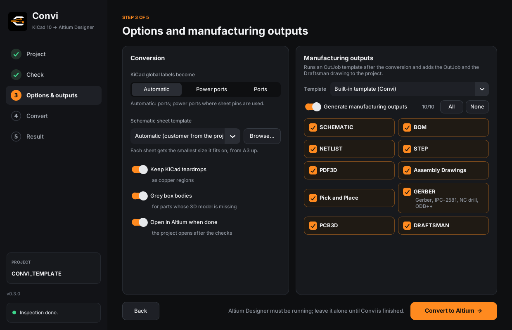
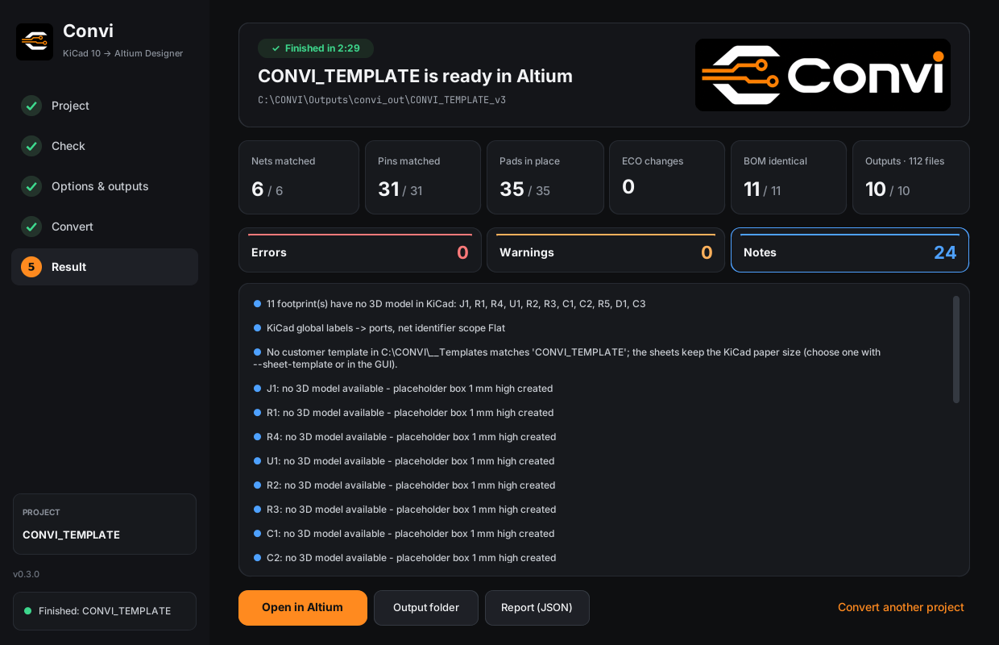
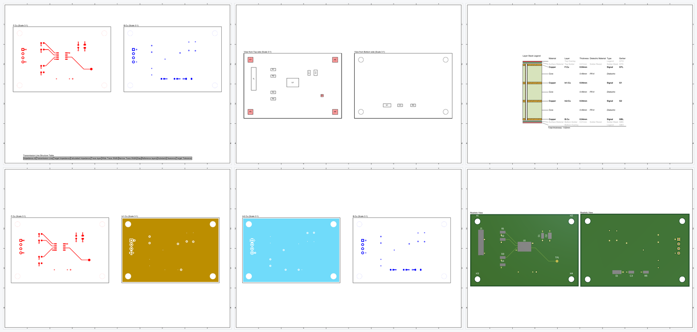

<p align="center">
  
</p>

<p align="center">
  <b>Convert complete KiCad projects into native Altium Designer projects, then verify the result.</b>
</p>

<p align="center">
  <a href="https://github.com/Microver-Electronics/Convi/actions/workflows/tests.yml"></a>
  <a href="LICENSE"></a>
  
  
  
  
  <a href="https://buymeacoffee.com/convi.tool"></a>
</p>

---

Convi takes a whole KiCad project (schematics, PCB, symbols, footprints and 3D models) and produces a
complete Altium Designer project that needs no manual clean-up. Altium Designer writes every file itself,
driven by Convi through its scripting interface, so the output is always valid native Altium data.

After building, Convi compiles the result in Altium and compares it with the KiCad design, pin by pin and
pad by pad. You get a report that tells you, in numbers, what matches and what (if anything) still differs.

## Contents

- [Features](#features)
- [Requirements](#requirements)
- [Installation](#installation)
- [Quick start](#quick-start)
- [Command line reference](#command-line-reference)
- [3D models](#3d-models)
- [Sheet templates](#sheet-templates)
- [Manufacturing outputs](#manufacturing-outputs)
- [Output and verification report](#output-and-verification-report)
- [What is converted](#what-is-converted)
- [Known limitations](#known-limitations)
- [Troubleshooting](#troubleshooting)
- [Development](#development)
- [Support](#support)
- [License](#license)

## Features

- **Complete projects**: `.PrjPcb`, one `.SchDoc` per sheet instance, `.SchLib`, `.PcbDoc` and `.PcbLib`
  with embedded STEP 3D bodies.
- **Exact connectivity**: KiCad nets are checked against Altium's compiled netlist pin by pin. A clean
  conversion shows *zero changes* in Altium's *Update PCB* (ECO) preview.
- **Hierarchical schematics**: ports and sheet entries, power ports, repeated sheets (one document per
  instance, so designators match the PCB), multi-unit symbols, buses, and KiCad group buses as Altium
  signal harnesses.
- **PCB as designed**: stack-up, board shape and cutouts, tracks, arcs, vias, keep-outs, teardrops,
  text and graphics; components placed exactly like Altium places library parts.
- **Design rules**: net classes, clearances, widths, via styles, differential pairs (also per layer),
  mask/paste, hole rules, KiCad custom rules (`.kicad_dru`), KiCad severities and DRC exclusions.
- **Copper pours**: zones become Altium polygons, poured in KiCad priority order and compared with
  KiCad's own fill.
- **BOM and variants**: fields and values preserved; DNP parts, test points, mounting holes and fiducials
  in a `DNP` variant (not fitted, out of the BOM).
- **3D models**: resolved from the project, your folders or KiCad's official library; missing models are
  listed before you convert.
- **Manufacturing outputs (optional)**: an Altium Output Job and Draftsman template, built in or your own,
  are retargeted to the converted board and run: Gerber / ODB++ / IPC-2581 / NC drill, BOM, pick and
  place, PDFs, STEP, netlists and a fabrication drawing with one view per copper layer.
- **Wizard**: a step-by-step interface (project, check, options, convert, result) with live progress and
  the verification results in numbers.
- **Honest reporting**: every remaining difference is reported and classified. Convi never changes
  clearances or deletes rules to make a report look clean.

## Requirements

| | |
|---|---|
| Operating system | Windows 10 or 11 |
| Altium Designer | 2026 recommended, 24 or later supported; installed and licensed |
| Python | 3.10 or newer ([python.org](https://www.python.org/downloads/), with the `py` launcher) |
| KiCad project | KiCad 10 (KiCad 6 to 9 and 10.99 files are read too) |
| Internet | Optional, only to download missing KiCad standard-library 3D models |

KiCad itself does not need to be installed. If it is, Convi also uses its local 3D model library.

## Installation

```bat
git clone https://github.com/Microver-Electronics/Convi.git
cd Convi
install.bat
```

`install.bat` runs `py -m pip install -e .`, which installs the dependencies (`zstandard`, `pillow`, `lz4`,
`customtkinter`) and the `convi` and `convi-gui` commands. Run it again if you move the folder or update
the repository.

## Quick start

### Wizard

Double-click **`Convi.bat`** (or run `convi-gui`). The wizard leads through five steps:

<p align="center">
  
  
</p>

1. **Project**: choose the KiCad project folder or its `.kicad_pro` file, or pick one from the list of
   projects in your [workspace](#workspace-optional) (double-click inspects it at once). The output
   folder is filled in for you.
2. **Check**: Convi reads everything and shows the project in numbers, the 3D models it cannot find and
   what else it noticed (sub-sheets, undefined path variables, custom rules ...). Add a folder with STEP
   files, assign a STEP file to selected models or define a KiCad path variable; the project is checked
   again.
3. **Options & outputs**: global labels, sheet template, teardrops, placeholder bodies, opening the result
   in Altium, and the optional [manufacturing outputs](#manufacturing-outputs).
4. **Convert**: Altium Designer starts if it is not running. **Do not use Altium until Convi has
   finished**; the stages and a live log are shown. Typical projects take one to six minutes, plus two to
   four minutes when all manufacturing outputs are generated.
5. **Result**: the verification in numbers (nets, pins, pads, ECO, BOM, outputs) with the errors, warnings
   and notes, and buttons for the project, the output folder and the report. Run *File > Save All* in
   Altium once (see [Output and verification report](#output-and-verification-report)).

Without CustomTkinter installed, or with the environment variable `CONVI_GUI=classic`, the previous
tabbed wizard starts instead.

### Command line

```bat
convi inspect path\to\MyBoard
convi convert path\to\MyBoard -y
```

## Command line reference

```text
convi inspect <project>  [common options]
convi convert <project>  [common options] [convert options]
convi gui
convi --version
```

`<project>` is a KiCad project folder or a `.kicad_pro`, `.kicad_sch` or `.kicad_pcb` file.

| Common option | Description |
|---|---|
| `-o, --out DIR` | Output folder. Default: `<project>\Altium`, or the workspace output folder (see [Workspace](#workspace-optional)) |
| `--models DIR` | Extra folder searched for STEP models by file name (repeatable) |
| `--map RAW=STEP` | Use this STEP file for the model path `RAW` as written in KiCad (repeatable) |
| `--var NAME=PATH` | Define a KiCad path variable, e.g. `--var KICAD_3RD_PARTY=D:\kicad\3rdparty` (repeatable) |
| `--no-auto-models` | Do not search the project's own `3dmodels` folders automatically |
| `--offline` | Do not download KiCad library 3D models |

| Convert option | Description |
|---|---|
| `-y, --yes` | Do not ask questions (otherwise Convi asks for missing 3D models) |
| `--global-labels auto\|power\|port` | How KiCad global labels are converted. `auto` (default): ports, or power ports when the design uses hierarchical sheet pins |
| `--sheet-template auto\|none\|CUSTOMER\|FILE.SchDot` | Draw sheets on your Altium templates (see [Sheet templates](#sheet-templates)) |
| `--placeholder-bodies` | Grey box bodies for parts whose 3D model is missing (never for test points, fiducials, mounting holes, DNP or BOM-excluded parts) |
| `--no-teardrops` | Skip KiCad teardrop areas (default: converted to copper regions) |
| `--outputs [all\|NAME,NAME]` | Also generate the [manufacturing outputs](#manufacturing-outputs): every container of the Output Job, or the named ones (e.g. `GERBER,BOM`) |
| `--list-outputs` | List the containers of the Output Job template and exit |
| `--output-template auto\|builtin\|DIR` | Which templates: `auto` (default; yours if found, else the built-in ones), `builtin`, or the folder of your own |
| `--altium PATH` | Path to Altium's `X2.EXE` if it is not found automatically |

Keep the output path free of non-ASCII characters.

### Workspace (optional)

For teams that convert many projects, Convi supports a simple workspace layout:

```text
CONVI/
  Tool/Convi/                 this repository
  Projects/<Name>/...         KiCad source projects
  Outputs/convi_out/<Name>    conversions written by Convi
```

The workspace is the first parent folder that contains `Tool`, `Projects` and `Outputs` (or the folder in
the `CONVI_WORKSPACE` environment variable). For a project in `Projects/<Name>/...`:

- the output goes to `Outputs/convi_out/<Name>`; an existing conversion is never overwritten, the next free
  `<Name>_v2`, `<Name>_v3` ... is used;
- every `3dmodels` folder inside `Projects/<Name>` is searched for STEP files automatically.

## 3D models

Convi resolves every model reference of the board in this order:

1. a STEP file you assigned to it (`--map` or *Assign STEP file* in the wizard);
2. a model embedded in the KiCad file (KiCad 9/10);
3. the path written in the footprint, with KiCad path variables resolved (including your `--var` values
   and a local KiCad installation);
4. the project's own `3dmodels` folders and any `--models` folder, by file name;
5. a download from KiCad's official 3D library, for KiCad standard-library models (cached in
   `%LOCALAPPDATA%\Convi`; off with `--offline`).

Models that cannot be found are listed by the inspection together with the parts that use them. Convi
does not substitute a different model by name, because vendor footprints carry offsets and rotations for
their own STEP files. Altium needs STEP: a `.wrl` reference is resolved to the `.step` file next to it.

## Sheet templates

Converted sheets can be drawn on your own Altium sheet templates (`.SchDot`). Put them in a folder named
`__Templates` (or any `__<Name>Templates`) next to the project or one of its parents, or set the
`CONVI_TEMPLATES` environment variable to the folder. Name the files:

```text
<size> - template - <customer>.SchDot      e.g.  A3 - template - Acme.SchDot
                                                  A2 - template - Acme.SchDot
```

With `--sheet-template auto` (the default) the customer whose name appears in the project name is used,
and every sheet gets the smallest size of that family it fits on. Title-block values (title, revision,
drawn by, checked by, ...) are filled from the KiCad project. Without a matching template the sheets keep
the KiCad paper size.

## Manufacturing outputs

Convi can add an Altium Output Job to the converted project and generate the manufacturing package with
it. A complete template is built in (`convi/templates/outputs`): an Output Job with ten containers and a
seven-sheet Draftsman fabrication drawing (title page with PCB properties, drill drawing and table, copper
layers, top and bottom assembly, layer stack legend, realistic views). It was made on a synthetic test board
and holds no data of any real product.

<p align="center">
  
  <br><sub>The built-in Draftsman template on its test board: copper layers, assembly views, layer stack, realistic views.</sub>
</p>

You can use your own instead: the Output Job (and Draftsman drawing) of a finished Altium project whose
outputs are set up the way you want them. Put the files in the folder named by the
`CONVI_OUTPUT_TEMPLATES` environment variable, in your sheet templates folder, or in the workspace root;
when Convi finds them they are the default, and the built-in template stays selectable:

```text
<Board>.OutJob             the Output Job; its file name is the template project's name
<Board>.DwfDot             optional: the Draftsman drawing (.DwfDot or .PCBDwf) of that project
```

Convi copies them into the converted project and adapts everything that belonged to the template board:

- paths, project name and output folders;
- the `DNP` variant for every output (BOM and pick and place leave out DNP parts, test points, mounting
  holes and fiducials);
- mechanical layers, matched by purpose (assembly, courtyard, 3D body, outline), read from the template
  board's layer names that the Draftsman drawing carries;
- copper layers: inner layers for Gerber, ODB++ and prints follow the converted board's layer count, and
  every drill pair the board uses is plotted;
- Draftsman: one layer view per copper layer (sheets are added as needed), board views scaled to fit their
  frame on the sheet, the drill table sized to the board's hole sizes.

In the wizard, choose the *Template* (yours, built-in, or another folder), switch on *Generate manufacturing
outputs* and tick the containers you want; on the command line use `--outputs` or `--outputs GERBER,BOM`,
with `--output-template builtin` or `--output-template DIR` to choose the templates. Files go to `Project Outputs` in the output folder; the
Output Job keeps all its containers, so the others can be run from Altium later.

## Output and verification report

```text
<output folder>/
  MyBoard.PrjPcb        project: hierarchical net scope, parameters, DNP variant, ERC matrix
  *.SchDoc              one per sheet instance, in KiCad page order
  MyBoard.SchLib        all symbols
  MyBoard.PcbDoc        the board, poured
  MyBoard.PcbLib        all footprints with embedded STEP bodies
  *.OutJob, *.PCBDwf    Output Job and Draftsman drawing (with manufacturing outputs)
  Project Outputs/      the generated manufacturing files (with manufacturing outputs)
  convi_report.json     the full verification report
  _convi/               logs, DRC report, read-back data, intermediate files
```

During the conversion Convi checks:

| Check | What is compared |
|---|---|
| Connectivity | Every KiCad pad net against Altium's compiled netlist, pin by pin |
| ECO preview | What *Design > Update PCB* would change; a clean conversion is `add 0, remove 0, re-link 0, footprint 0, pad-net 0` |
| Placement | The first pad of every component against KiCad's coordinates |
| PCB read-back | Every pad (position and net), track, arc and via of the saved PcbDoc (`_convi/pcbcheck.json`) |
| BOM | Parts, values and fields (`_convi/bom_check.csv`) |
| Altium DRC | Shorts, unrouted connections, clearances (`_convi/drc_report.txt`) |
| Copper pours | Poured area of every polygon against KiCad's zone fill |

Remaining DRC items are classified in the report: connections KiCad itself leaves unrouted, checks the
KiCad project sets to *warning*, pairs excluded in KiCad's DRC, and real conversion differences. Only
the last group needs your attention. ERC warnings of the type "no driving source" come from the source
design and are kept on purpose.

## What is converted

| KiCad | Altium |
|---|---|
| `.kicad_pro` | `.PrjPcb`: hierarchical net scope, parameters, DNP variant, net classes, ERC pin matrix |
| Schematic sheets | `.SchDoc` per sheet instance; local labels to net labels, hierarchical labels to ports and sheet entries, global labels to power ports or ports, power symbols to power ports |
| Symbol library | `.SchLib`: multi-unit symbols, De Morgan, pin types, hidden power pins |
| Group buses (`PREFIX{ALIAS}`) | Signal harnesses (connectors, entries, harness ports) |
| `.kicad_pcb` | `.PcbDoc`: stack-up, board shape and cutouts, components, tracks, arcs, vias, text, graphics, tables |
| Footprints | `.PcbLib`: one footprint per unique geometry, built in library frame |
| Zones and rule areas | Polygons (pour order from priority), keep-out regions, rooms |
| Rules and net classes | Altium rules in KiCad's resolution order, net classes, differential pairs |
| `.kicad_dru` custom rules | Altium rules with equivalent query scopes |
| 3D models | Embedded STEP component bodies |

The complete mapping, with the reasoning behind each decision, is documented in [brain.md](brain.md).

## Known limitations

- **Pour engine**: Altium's pour engine is not KiCad's filler. Very narrow copper that KiCad keeps between
  fine-pitch pads can leave a pad unconnected in Altium; Convi reports such pads instead of changing your
  clearances. Pour corners at rectangular pads are square in Altium.
- **Custom rules** that Altium queries cannot express (terms that compare both objects, such as
  `A.Layer == B.Layer`, or `insideCourtyard()`, `Pad_Type`) are listed in the report, not converted.
- **Not converted**: PCB barcodes and reference images, KiCad schematic variants beyond DNP, the KiCad DNP
  cross on symbols (Altium shows "Not Fitted" when the variant is active).
- **Not yet tested** on real projects: blind/buried vias, flex and rigid-flex, hatched pours.
- Third-party 3D models that existed only on the original designer's computer must be supplied by you.
- **Manufacturing outputs**: Draftsman's *Transmission Line Structure* table stays empty, because KiCad
  projects define no Layer Stack Manager impedance profiles. Very wide boards are drawn side by side at a
  smaller scale; assembly print pages keep the template's scale.
- **Part values** are not shown on the board, as in Altium's own libraries
  (they stay in the BOM and the component parameters); the silkscreen keeps the designators and the
  texts drawn by the designer.

## Troubleshooting

| Problem | What to do |
|---|---|
| A dialog appears in Altium during the conversion | Convi handles known dialogs itself; do not click in Altium. If a script error appears, its picture is saved to `_convi/altium_error.png`. |
| "Cannot convert: fix the blocking problems" | Run `convi inspect` and resolve the listed items (missing sub-sheets, unreadable files). |
| Many 3D models are missing | Add the folder with the vendor's STEP files (`--models` or the wizard), or define the path variable the footprints use (`--var`). |
| The wizard looks like a plain tabbed window | CustomTkinter is missing: run `install.bat` again. |
| "Missing file" when a Draftsman PDF is published | A failed publish can leave a locked, almost empty PDF. Restart Altium, then convert again. |
| `convi` is not recognised | Run `install.bat` again, or use `py -m convi ...` from the repository folder. |
| Altium is not found | Pass `--altium` with the path to your version's `X2.EXE`, e.g. `C:\Program Files\Altium\AD26\X2.EXE`. |
| The result differs from KiCad | Open `convi_report.json`. If the difference is not a known limitation, please open an issue (see [CONTRIBUTING.md](CONTRIBUTING.md)). |

## Development

```bat
py -m pip install -e .[dev]
py -m pytest -q tests
```

The offline tests need no Altium. Four of them also use KiCad's demo projects in
`testdata/kicad-src/demos` (the `demos` folder of the KiCad source repository) and are skipped without them.

- [brain.md](brain.md): architecture, every verified Altium and KiCad fact the converter relies on, the
  working rules and the open items. Read it before changing code.
- [CONTRIBUTING.md](CONTRIBUTING.md): how to report problems and the checks a change must pass.
- [devtools/](devtools/README.md): probes and helpers for working with Altium's scripting interface.

```text
convi/kicad      KiCad readers (S-expression, PCB, schematic, project, embedded files)
convi/convert    KiCad to intermediate representation (PCB, libraries, schematic, rules, project file)
convi/altium     Altium side: DelphiScript builders, script runner, verification scripts
convi/*.py       inspection, pipeline, verification, workspace, command line and wizard
devtools/        development probes and helpers
tests/           offline tests
docs/images/     logo and banner
```

## Support

Convi is free and stays free. If it saved you a day of manual rework, you can
[buy me a coffee](https://buymeacoffee.com/convi.tool). Support is voluntary and does not buy priority
support or any warranty; bug reports and feature requests are welcome in the GitHub issues for everyone.

## License

Convi is released under the [MIT License](LICENSE). See [THIRD_PARTY_NOTICES.md](THIRD_PARTY_NOTICES.md)
for dependencies, KiCad library data and trademarks.

Convi is an independent project. It is not affiliated with, endorsed by or sponsored by Altium or the
KiCad project. Altium Designer is a trademark of its owner; KiCad is a trademark of its owner.
